# cpp-elearning-platform-raylib
<div align="center">


<br>


**[Screens](#-the-application) · [Features](#-what-it-does) · [Architecture](#-architecture) · [OOP showcase](#-oop-showcase) · [Run it](#-getting-started) · [Roadmap](#-roadmap)**

</div>


## ✦ Overview

**SAM** (Smart Academic Manager) is a desktop learning platform where **students, teachers and admins** each get their own workspace. Students enroll in courses, take quizzes, track tasks and read their gradebook. Teachers publish courses, post assignments and grade submissions. Admins approve courses, manage accounts and watch enrollments and subscription plans.

It is written in **C++17**, drawn entirely with **raylib** (immediate-mode GUI, 23 screens, no GUI framework), and stores everything in plain **CSV files** through a small `FileHandler` class, so there is no database to install. Alongside the running app, the repository contains a **24-class object-oriented domain model** (abstract bases, interfaces, polymorphic courses, exceptions, operator overloading) described in detail [below](#-oop-showcase).


## ✦ The application

Every image below is a real capture of the compiled app, not a mock-up. They are cropped to the used area of the 1920×1080 window.

<div align="center">
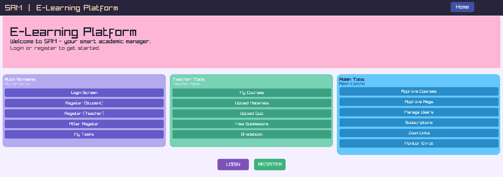
<br><sub><b>Home</b> — quick access cards for the auth, teacher and admin areas</sub>
</div>

<br>

<table>
<tr>
<td width="50%" align="center">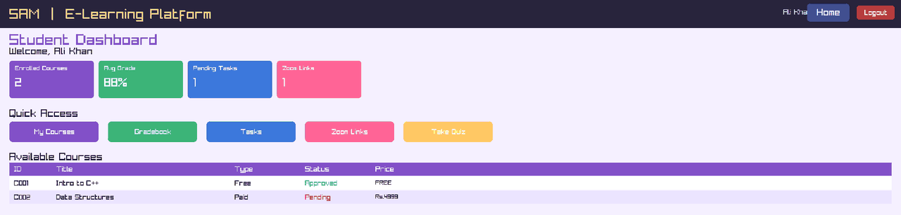<br><sub><b>Student dashboard</b> — live counters and course table</sub></td>
<td width="50%" align="center">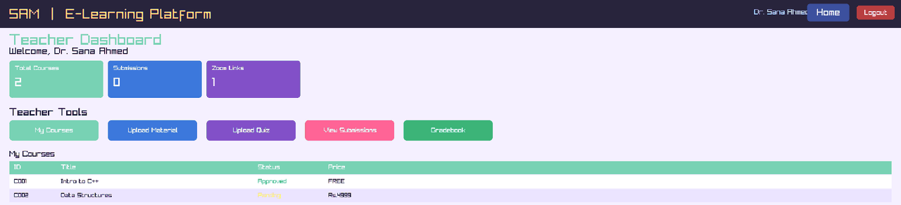<br><sub><b>Teacher dashboard</b> — courses with Approved / Pending status</sub></td>
</tr>
<tr>
<td width="50%" align="center">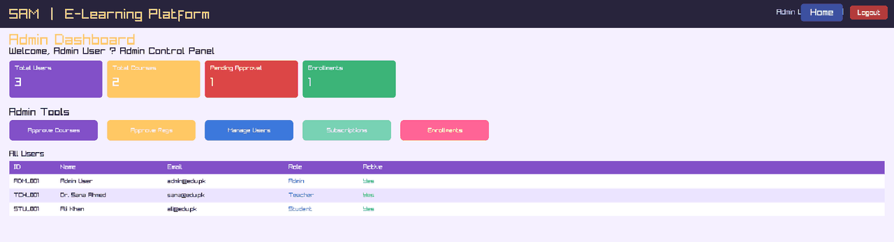<br><sub><b>Admin dashboard</b> — users, pending approvals, enrollments</sub></td>
<td width="50%" align="center">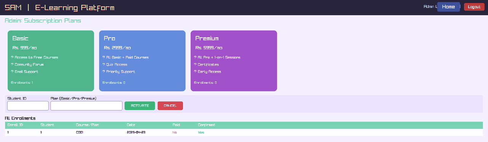<br><sub><b>Subscriptions</b> — Basic, Pro and Premium plans</sub></td>
</tr>
<tr>
<td width="50%" align="center">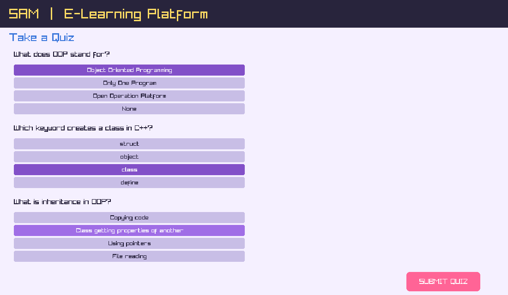<br><sub><b>Quiz</b> — multiple choice with instant scoring</sub></td>
<td width="50%" align="center">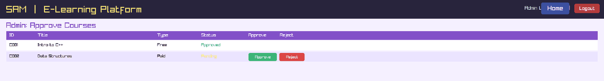<br><sub><b>Approve courses</b> — one click to approve or reject</sub></td>
</tr>
</table>


## ✦ What it does

<table>
<tr>
<td width="33%" valign="top">

### 🔐 Role-based login
Pick **Student, Teacher or Admin** at login. Credentials are checked by `FileHandler::checkLogin`, and a correct password with the wrong role is rejected. The three dashboards are guarded by `requireRole(...)`.

</td>
<td width="33%" valign="top">

### 🎓 Student workspace
Dashboard counters, a course catalogue with **enroll-by-ID**, a gradebook with **PASS / FAIL** at 50% and a class average, plus a personal **task planner** with High / Medium / Low priority.

</td>
<td width="33%" valign="top">

### 🏅 Quiz and badges
A built-in three-question OOP quiz scored out of 30 that awards a **Bronze to Platinum** tier and logs each attempt. The gradebook turns your average into a badge too: Bronze 40%, Silver 60%, Gold 75%, Platinum 90%.

</td>
</tr>
<tr>
<td valign="top">

### 🧑‍🏫 Teacher studio
Create **Free or Paid** courses (they enter as *Pending*), record uploaded materials, create assignments with deadline and max marks, **grade submissions by ID** and add gradebook entries.

</td>
<td valign="top">

### 🛡️ Admin console
**Approve or reject** courses, **activate, ban or remove** accounts, **reset passwords**, and review every enrollment with its *Paid* and *Confirmed* state.

</td>
<td valign="top">

### 💳 Subscription plans
Basic (Rs. 999/mo), Pro (Rs. 2999/mo) and Premium (Rs. 5999/mo) cards, with **activate / cancel** by student ID recorded as paid enrollments.

</td>
</tr>
<tr>
<td valign="top">

### 📹 Class links
Add **Zoom links** with teacher, section, course and scheduled time; everything lands in one table that students can open from their dashboard.

</td>
<td valign="top">

### 🗂️ Plain-file persistence
Ten CSV files under `data/`, written by `FileHandler` with a quote-aware CSV reader and writer. First run **seeds demo data** automatically.

</td>
<td valign="top">

### 🧾 Activity log
Registrations, enrollments, course changes, grading, password resets and quiz attempts are appended to `activity_log.csv`.

</td>
</tr>
</table>

### How a course moves through the system

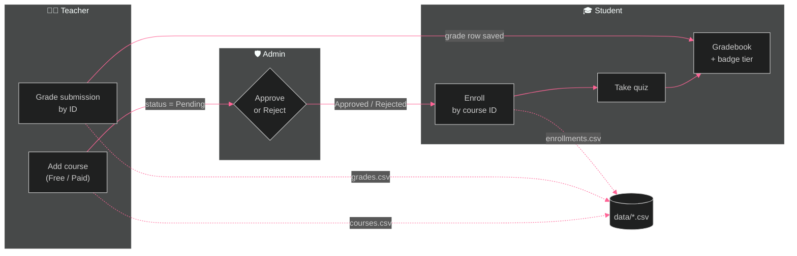


## ✦ Architecture

<div align="center">
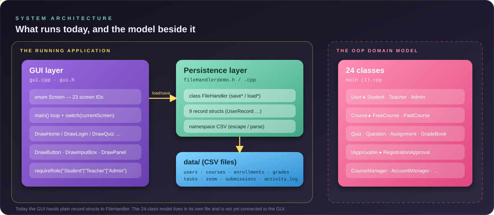
</div>

<br>

| Layer | Files | Responsibility |
|---|---|---|
| **GUI** | `gui.cpp`, `gui.h` | `main()` loop, the `Screen` enum (23 IDs), one `DrawXxx()` function per screen, shared widgets (`DrawButton`, `DrawInputBox`, `DrawPanel`), role guard, theme colors |
| **Persistence** | `fileHandlerdemo.h`, `fileHandlerdemo (1).cpp` | `FileHandler` class, nine record structs, `CSV` namespace helpers (`nextField`, `escField`, `copyStr`), activity log |
| **Domain model** | `main (1).cpp` | The 24 OOP classes: users, courses, quizzes, grading, approvals, subscriptions. A standalone design with no `main()` of its own |

The GUI keeps in-memory arrays (`gUsers`, `gCourses`, `gGrades`, …) filled by `reloadAll()`, draws them every frame, and writes them back through `FileHandler` whenever a button changes something.


## ✦ OOP showcase

The class model in `main (1).cpp` captures the whole platform as objects. Two diagrams below, drawn from the real declarations: the **people and course core**, then the **learning, grading and governance** classes around it.

### Core: users, courses and student helpers

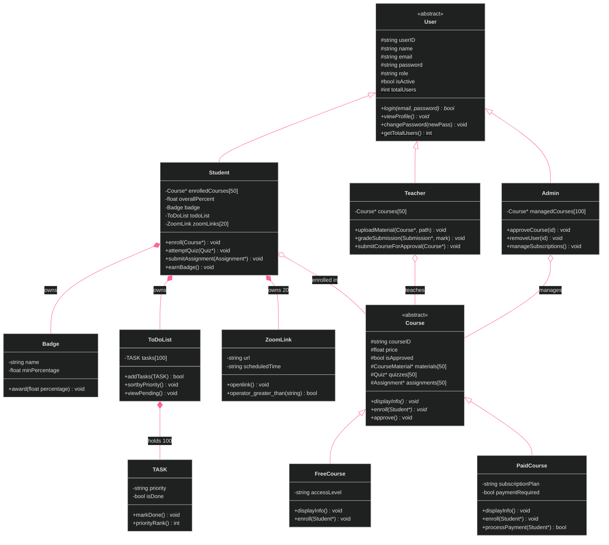

### Around the core: learning, grading and governance

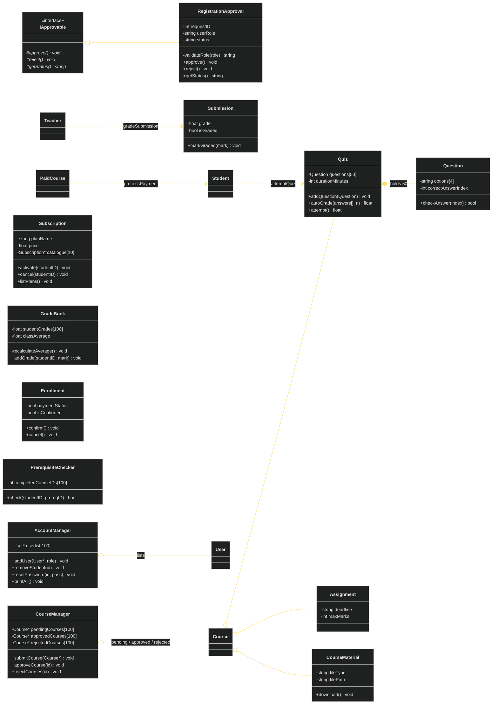

<sub>`*` abstract / pure virtual · `$` static · `#` protected, `-` private, `+` public. `ZoomLink::operator_greater_than` is the diagram's spelling of `operator>`, which Mermaid cannot display. `GradeBook`, `Enrollment`, `PrerequisiteChecker`, `Assignment` and `Submission` are self-contained building blocks that other classes reference by ID or pointer.</sub>

### OOP concepts, mapped to real code

| Concept | Where it lives | What it does |
|---|---|---|
| **Abstraction** | `User` (L20), `Course` (L292), `IApprovable` (L1567) | Pure virtual `login`, `viewProfile`, `displayInfo`, `enroll`, `approve`, `reject`, `getStatus` define contracts the base classes cannot fulfil themselves |
| **Inheritance** | `Student`, `Teacher`, `Admin` ← `User`; `FreeCourse`, `PaidCourse` ← `Course`; `RegistrationApproval` ← `IApprovable` | Derived constructors chain upward, e.g. `Teacher : User("", name, email, password, "Teacher")` |
| **Polymorphism** | `Course::enroll`, `Course::displayInfo`, `User::viewProfile` | `FreeCourse::enroll` enrolls straight away; `PaidCourse::enroll` checks approval, then calls `processPayment`. `CourseManager::getPending` and `AccountManager::printAll` call the overridden methods through base-class pointers |
| **Encapsulation** | every class | Data is `private` or `protected`; behaviour is exposed through getters and methods. Internal helpers stay private: `GradeBook::recalculateAverage`, `CourseManager::findInAll`, `RegistrationApproval::validateRole`, `FileHandler::buildPath` |
| **Composition** | `Student`, `ToDoList`, `Quiz` | `Student` owns a `Badge`, a `ToDoList` and `ZoomLink[20]` by value; `ToDoList` owns `TASK[100]`; `Quiz` owns `Question[50]` |
| **Aggregation** | `Course`, `CourseManager`, `AccountManager`, `Teacher`, `Student`, `Admin` | Hold `Course*` / `User*` / `Quiz*` pointers to objects they do not own |
| **Static members** | `User::totalUsers`, per-class `nextID`, `Subscription::catalogue` | Auto-incrementing IDs in `Question`, `Quiz`, `Assignment`, `Submission`, `Enrollment`, `CourseMaterial`, `Badge`, `TASK`; a self-registering plan catalogue with `Subscription::listPlans()` |
| **Operator overloading** | `ZoomLink::operator>(const string&)` (L1368) | Compares a link's `scheduledTime` with a given time string |
| **Exception handling** | `RegistrationApproval`, `CourseManager`, `AccountManager`, `Subscription` | 29 `throw` sites using `invalid_argument`, `runtime_error`, `out_of_range`, `overflow_error`, for example approving a request twice or submitting a duplicate course |
| **Constructors** | `Badge`, `TASK`, `ToDoList`, `Question` | Default and parameterised constructors, member-initialiser lists, default arguments such as `prereqID = 0` |
| **const-correctness** | `display() const`, getters, `addTasks(const TASK&)` | Read-only methods are marked `const` |
| **Namespaces** | `namespace CSV` | CSV parsing helpers kept out of the global scope |

### Objects in action

This snippet was compiled and run against the real `main (1).cpp`:

```cpp
#include "main (1).cpp"

int main() {
    Student       ali("Ali Khan", "ali@edu.pk", "pass123");
    FreeCourse    intro("C001", "Intro to C++", "Learn C++ from scratch", 0, 1);
    PaidCourse    ds("C002", "Data Structures", "Advanced DS with C++", 4999, 1, "Pro");

    CourseManager cm;
    cm.submitCourse(&intro);
    cm.submitCourse(&ds);
    cm.approveCourse("C002");
    ds.approve();

    Course* catalog[] = { &intro, &ds };      // one array, two behaviours
    for (Course* c : catalog) c->enroll(&ali);

    try {
        RegistrationApproval r(5, "Student");
        r.approve();
        r.approve();                           // second approval throws
    } catch (const runtime_error& e) {
        cout << "caught: " << e.what() << endl;
    }
}
```

```text
Enrolling in free course: Intro to C++
Ali Khan enrolled in: Intro to C++
Enrolled successfully!
Attempting to enroll in paid course: Data Structures
Processing payment of Rs.4999...
Payment successful!
Ali Khan enrolled in: Data Structures
Enrolled in paid course successfully!
caught: Request 1 already processed
```

### Design decisions

- **Contracts first.** `User` and `Course` declare *what* every subclass must do and leave *how* to the subclass, so new user types or course types plug in without touching the callers.
- **Managers hold pointers, not copies.** `CourseManager` moves a `Course*` between pending, approved and rejected lists; the course object itself never moves.
- **Fail loudly in the model.** Invalid roles, duplicate IDs, full lists and double approvals throw typed exceptions instead of silently doing nothing.
- **Presentation and storage stay apart.** The GUI never touches files directly; all disk access goes through `FileHandler`.


## ✦ Data files

`FileHandler` reads and writes these files in `data/` (created on first run). Each `load*` / `save*` pair maps a CSV file to a record struct.

| File | Record struct | Used by |
|---|---|---|
| `users.csv` | `UserRecord` | login, registration, admin user tools |
| `courses.csv` | `CourseRecord` | catalogue, teacher courses, approvals |
| `enrollments.csv` | `EnrollmentRecord` | enrolling, subscriptions, monitoring |
| `grades.csv` | `GradeRecord` | gradebooks |
| `tasks.csv` | `TaskRecord` | student task planner |
| `zoom.csv` | `ZoomLinkRecord` | class links |
| `submissions.csv` | `SubmissionRecord` | grading |
| `assignments.csv` | `AssignmentRecord` | assignments and uploaded-material records |
| `materials.csv` | `MaterialRecord` | supported by `FileHandler`; not yet used by a screen |
| `activity_log.csv` | — | append-only audit trail |

## ✦ Tech stack

| | |
|---|---|
| **Language** | C++17 |
| **GUI / rendering** | [raylib 5.0](https://www.raylib.com/) (immediate-mode drawing and input) |
| **Standard library** | `<string>`, `<fstream>`, `<iostream>`, `<stdexcept>`, `<cstring>` |
| **Storage** | CSV files via `FileHandler` |
| **Compiler** | `g++` (GCC 13.3 used for verification) |

## ✦ Getting started

### Prerequisites

- A C++17 compiler (`g++`)
- **raylib 5.0** headers and library for your platform
- A desktop session (the app opens a window)

### 1 · Clone

```bash
git clone <your-repository-url>
cd <your-repository-folder>
```

### 2 · Build and run on Linux (verified on Ubuntu 24.04)

```bash
# toolchain and raylib's X11/OpenGL dependencies
sudo apt install build-essential git libgl-dev libxrandr-dev libxinerama-dev libxcursor-dev libxi-dev

# raylib 5.0 as a static library
git clone --depth 1 --branch 5.0 https://github.com/raysan5/raylib.git
make -C raylib/src PLATFORM=PLATFORM_DESKTOP

# compile BOTH source files
g++ -std=c++17 gui.cpp "fileHandlerdemo (1).cpp" -o SAM \
    -I raylib/src -L raylib/src -lraylib -lGL -lm -lpthread -ldl -lrt -lX11

./SAM
```

### Build on Windows (MinGW-w64)

*Not verified in the environment used to write this README.* The repository's `libraylib.a` is a Windows/MinGW archive, so with raylib 5.0 installed (for example in `C:/raylib`):

```bash
g++ -std=c++17 gui.cpp "fileHandlerdemo (1).cpp" -o SAM -I"C:/raylib/include" -L"C:/raylib/lib" -lraylib -lopengl32 -lgdi32 -lwinmm
./SAM
```

### Demo accounts

On first launch, if `data/users.csv` is empty, SAM seeds three accounts and sample data:

| Role | Email | Password |
|---|---|---|
| Student | `ali@edu.pk` | `pass123` |
| Teacher | `sana@edu.pk` | `teach99` |
| Admin | `admin@edu.pk` | `admin123` |

Choose the matching role button on the login screen. Delete the `data/` folder to reset everything.

### Try the OOP model on its own

`main (1).cpp` has no `main()`, so write a small driver (like the one in [Objects in action](#objects-in-action)) and compile it by itself:

```bash
g++ -std=c++17 demo.cpp -o demo && ./demo
```

### Troubleshooting

| Symptom | Fix |
|---|---|
| `undefined reference to FileHandler::…` | Compile **both** `gui.cpp` and `fileHandlerdemo (1).cpp`, as in the commands above |
| `raylib.h: No such file or directory` | Pass `-I` pointing at your raylib 5.0 `src` (or `include`) folder |
| Linker errors for `X11`, `GL`, `Xrandr` | Install the `-dev` packages listed above |
| `data/` appears in the wrong place | Run `./SAM` from the repository root; the folder is created in the working directory |
| Window will not open over SSH or in a container | raylib needs a display; run on a desktop session |

## ✦ Project structure

```text
.
├── gui.cpp                      # main(), all 23 screens, widgets, role guard
├── gui.h                        # Screen enum, theme colors, shared declarations
├── fileHandlerdemo.h            # record structs, CSV namespace, FileHandler class
├── fileHandlerdemo (1).cpp      # FileHandler + CSV helper implementations
├── main (1).cpp                 # 24-class OOP domain model (no main())
├── ClassDiagram_ELearning.docx  # original class diagram document
├── ELearning_OOP_Project_FinalReport.docx
├── assets/
│   ├── readme-hero.svg          # animated banner
│   ├── architecture.svg         # layer diagram
│   ├── divider.svg
│   └── screenshots/             # real captures of the running app
└── data/                        # CSV storage, created on first run
```

## ✦ Roadmap

The running app and the class model were built side by side. Natural next steps:

- **Connect the two halves.** Have the GUI create and use `Student`, `Course`, `Quiz` and friends instead of passing plain record structs to `FileHandler`.
- **Guard every screen.** Today the three dashboards call `requireRole`; the teacher and admin screens reachable from the Home cards do not.
- **Secure credentials.** Store salted password hashes instead of plain text in `users.csv`.
- **Enforce account approval.** Registration currently creates active accounts, and login does not check `isActive`.
- **Per-user data.** Dashboards and enrollment currently work on shared data and a fixed student ID.
- **Editable quizzes.** The quiz screen ships three built-in questions; wire it to `Quiz` and `Question`.

## ✦ Team

| Contributor | Focus |
|---|---|
| **Arfa Ashraf https://github.com/arfa-ashraf** | Class diagram, user hierarchy, login and registration screens |
| **Maryam Amin https://github.com/aminmaryam** | Course hierarchy, quiz / assignment / grading classes, teacher dashboard |
| **Sumaiya Abubakar** | Student helpers, admin helpers, student and admin dashboards |

<div align="center">


<sub>Built with C++ and raylib · SAM — Smart Academic Manager</sub>

</div>
